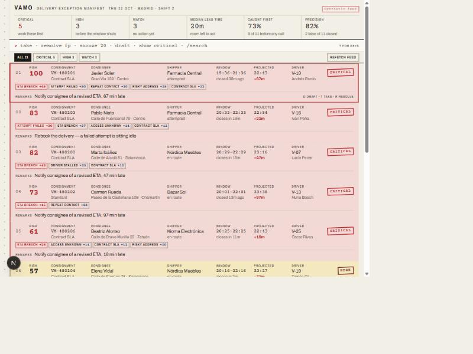

# Vamo Ops Radar

One ranked queue of the deliveries that are about to fail — with the reason and the next
move already on the row.

Built as a take-home for Vamo. **Development time: ~2 hours** (write-up, README and Loom
excluded, as the brief allows). See [WRITEUP.md](./WRITEUP.md) for the short version.



---

## The problem I picked

Vamo's ops team finds out about incidents when someone complains. The complaint *is* the
alert. By then the window is blown, the customer is angry, and the operator has to
reconstruct what happened across the dispatch tool, the driver's WhatsApp and the
shipper's email.

The expensive thing is not the incident. It is the **latency between the incident
happening and an operator knowing about it**. Every minute of that latency turns a fixable
delay into a failed delivery, a support ticket and an SLA credit.

So Radar is not a better dispatch tool, a better map or a better CRM. It compresses that
latency to near zero and hands the operator the first move.

Full product reasoning, including who it is for and what success looks like:
[PRODUCT.md](./PRODUCT.md).

---

## How it works

### The risk engine — [`src/lib/risk.ts`](src/lib/risk.ts)

A transparent additive model over eight signals, scored 0–100 and clamped. Deliberately
**not** a learned model and **not** an LLM:

- An operator who cannot see why a row scores 72 will not trust the row, and an untrusted
  queue gets worked out of order — at which point the ranking, which is the actual
  product, is worthless.
- Every weight lives in one `TUNING` object, so an ops lead who understands the operation
  but not machine learning can argue with it and change it.
- It is pure and synchronous, so it is unit-testable and runs identically on the server
  and in the browser.

| Signal | Fires when | Max points |
|---|---|---|
| `eta_breach` | Projected arrival lands past the promised window, by more than the noise floor | 45 |
| `failed_attempt` | Status is attempted or failed with no reattempt booked | 30 |
| `repeat_contact` | The consignee has chased us 2+ times in 90 min | 28 |
| `driver_stalled` | Vehicle hasn't moved for 12+ min, off-geofence, and this stop is within 2 h | 25 |
| `window_closing` | Still undispatched with ≤25 min of window left; escalates once it is past | 40 |
| `address_risk` | Prior failed attempts, a hand correction, or no unit number | 15 |
| `access_risk` | Building needs an entry code and none is on file | 14 |
| `sla_account` | Shipper carries a contractual penalty window | 12 |

Tiers: **critical** ≥ 60, **high** ≥ 40, **watch** ≥ 20, below that it stays off the queue.

Arrival is projected from the stop's position in the driver's route:
`now + leg + stopsAhead × (service + leg)`. A stall needs no term of its own — while the
vehicle sits still `now` advances and `stopsAhead` does not, so the projection slips on its
own. `driver_stalled` exists to name the cause, not to double-count the delay.

### The suggested play — [`src/lib/plays.ts`](src/lib/plays.ts)

A queue that only says "this is bad" leaves the operator to work out what to do, which is
the slow part. Each incident carries **one** next move, derived from its heaviest signal.
One move, not a menu: a busy operator handed five options is back to deciding.

### Where the LLM is, and where it is not — [`src/lib/draft.ts`](src/lib/draft.ts)

Deciding *what is wrong* and *what to do* is the engine's job: deterministic, testable,
explainable. Writing the sentence that goes to an upset customer is language work, which
is what a model is good at. So the model drafts the outbound message and nothing else.

Every draft has a template behind it. A missing API key, a rate limit or a refusal degrades
to the template, and the UI says which one you are looking at — an ops tool cannot have a
dead button.

### The surface — [`src/components/Radar.tsx`](src/components/Radar.tsx)

One screen, because the operator has one question. Every row answers three things without a
click: how urgent, why (signals with their point values on the face of the row), and what
to do. The detail sheet shows the score as arithmetic you can check, line by line.

Commands rehearse before they commit: typing `resolve fp critical` fades the affected
blocks toward absence and stamps each one faintly while a delta strip counts exactly what
would change. Enter keeps what is already visibly true; Esc lifts it with no residue.

The visual language is the consignment note this industry already runs on — fanfold stock,
punched tractor-feed edge, engraved captions, rubber-stamped dispositions. It is not
decoration: NCR copy tints are a severity code operators already read, a stamp is already a
disposition code, and a form's total box is already how you show arithmetic. Reasoning in
[DESIGN.md](./DESIGN.md).

---

## Running it

```bash
npm install
npm run dev
```

Then open <http://localhost:3000>.

The board works with no configuration. To have Claude write the outbound messages instead
of falling back to the stock wording:

```bash
cp .env.example .env.local
# then put your key in ANTHROPIC_API_KEY
```

| Variable | Required | What it does |
|---|---|---|
| `ANTHROPIC_API_KEY` | no | Without it, `/api/draft` returns the stock template and says so |
| `ANTHROPIC_WORKSPACE_ID` | no | Sent as `anthropic-workspace-id`; needed only for identity-linked keys |

```bash
npm test          # 91 unit tests
npm run build     # production build
npx eslint .      # lint
```

---

## Keys and commands

| Key | What it does |
|---|---|
| `j` / `k` | Move down and up the manifest |
| `Enter` | Pull the carbon copy for the selected block |
| `t` · `d` · `s` | Take · draft the message · snooze 15 min |
| `r` | Start a resolve, then pick the reason |
| `/` · `c` · `?` | Search · jump to the command rule · keys sheet |

Commands: `take`, `resolve <reason>`, `snooze <min>`, `draft`, `show <tier>`, `find <text>`.
Any of them takes a target — a consignment number or a whole tier — so
`resolve fp watch` closes a batch in one press.

---

## Measuring whether it works

The headline is **lead time**: minutes between Radar flagging a delivery and the window
breaching. Below roughly twenty minutes there is no play left to make, only an apology.
Next to it, the share of incidents flagged before any inbound contact — the product's
thesis, shown live.

Both are derived from the board on screen rather than configured, because a claim that the
tool buys you time has to be measurable from what it is actually showing you.

Precision comes from the operator: **false positive** is a first-class resolve reason, not a
courtesy option. It is the only honest source of precision data, and precision decides
whether the queue deserves anyone's attention. The anti-metric is the number of alerts —
more alerts is the failure mode, not the goal.

---

## What is deliberately not here

- **No live map.** The operator already has one, and a map answers "where" when the
  question is "what do I do".
- **No persistence.** Taking, snoozing and resolving live in memory for the session. The
  seam where a real store plugs in is `src/lib/operator.ts`.
- **No real integrations, auth or multi-tenancy.**
- **Messages are drafted, not sent.** The send button would be a webhook away and is not
  the interesting part.
- **No driver app, proof-of-delivery storage, historical analytics or shipper portal.**

### Known limits

- **The additive model cannot learn interactions.** A stalled driver on a contract account
  in rush hour is worse than the sum of its parts, and this model cannot know that. The
  honest upgrade path is to keep the additive score as the explanation and let a learned
  model re-rank within a tier — never to replace the explanation.
- **The draft endpoint trusts its caller.** The browser supplies the facts that go into the
  prompt, which is only acceptable because the feed is synthetic. Against real data the
  route would look the delivery up server-side by id; a client that can dictate prompt
  contents can dictate what gets sent to a customer. Inputs are validated and clamped
  either way (`parseDraftRequest`).
- **The model path is unverified against the live API.** I had no API key in the build
  environment, so the fallback path is exercised and the model path is not. The request
  shape follows the current SDK, and `npm test` covers the prompt construction, but treat
  the first live call as unproven.
- **Copy is English only**, and the strings are not externalised. Operators would very
  likely run this in Spanish.

---

## The data

The feed is **synthetic** and says so on the masthead. It is generated by
[`src/lib/seed.ts`](src/lib/seed.ts) from a fixed PRNG, with timings relative to the
request so the board always reads as live, and incidents written out as named scenarios
rather than sampled — random flags produce either a board of nothing or a board of
everything, and neither teaches you anything.

That module is the only one that gets thrown away against a real dispatch system.
Everything downstream consumes an `OperationSnapshot` and does not care where it came from;
`/api/feed` is the seam.

---

## Stack

Next.js 16 (App Router, Cache Components), React 19, TypeScript, Tailwind 4 for the reset
only — the surface is hand-written CSS against a token set — Vitest, `@anthropic-ai/sdk`.

```
src/lib/        domain · risk · plays · stats · commands · operator · draft · seed  (+ tests)
src/components/ Radar · Masthead · CommandRule · ManifestBlock · CarbonCopy · BlankSheet
src/app/        page · api/feed · api/draft
```
