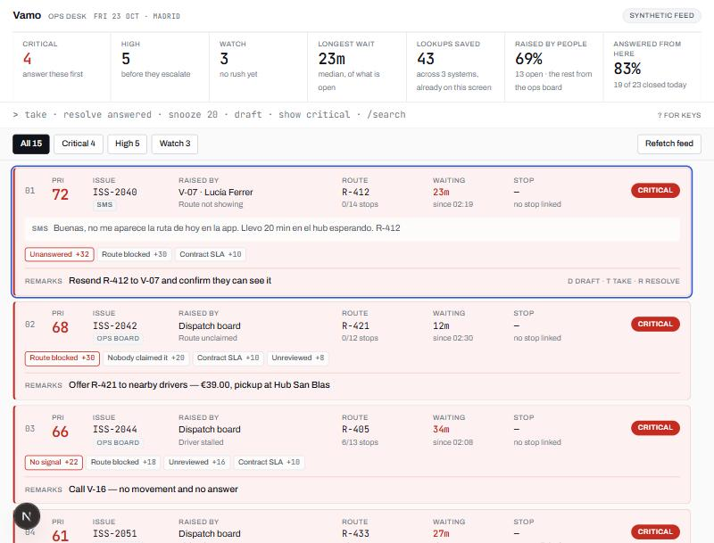
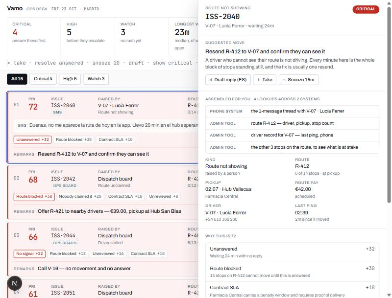

# Vamo Ops Desk

Every issue reaching the ops team in one ranked queue, with the context already assembled
and the reply drafted.

Built as a take-home for Vamo. See [WRITEUP.md](./WRITEUP.md) for the short version.



---

## The problem I picked

The follow-up to the brief rules out the obvious answer. Vamo's ops board **already** flags
stalled drivers, late pickups, cancellations and deliveries marked far from the address, and
customers already get an automated late text. Building a detector would be rebuilding what
they have.

What still lands on a human arrives as a text, a call, a Slack thread or an email — and most
of it is driver-side: *where is my route*, *what does this pay*, *I was paid short*, *nobody
took this route*, *I'm stuck at the pickup with three bags missing*. Then their own sentence
names the cost:

> "The context for any one problem is spread across our phone system, Slack threads and the
> admin tool, so the team pieces it together by hand."

So the product is not detection. It is **assembly**. The unit of work is an issue, not a
delivery, and the job is to collapse three systems into one screen and propose the answer.

Full reasoning, including who it is for and how it is measured: [PRODUCT.md](./PRODUCT.md).

---

## How it works

### Issues, from two directions — [`src/lib/domain.ts`](src/lib/domain.ts)

An issue arrives either from their ops board (`source: "detected"` — we ingest their flags
instead of recomputing them) or from a person. From there the handling is identical.

### Classification — [`src/lib/classify.ts`](src/lib/classify.ts)

Inbound messages are Spanish, because the drivers are in Madrid. Rules read both Spanish and
English, pick the kind, and pull out `R-412` / `VM-480200` references. An LLM does this
better on the messy cases, but the rules stay as the floor: a queue that silently stops
sorting when a model is rate-limited is worse than one that sorts a little worse.

When nothing matches it returns `unknown` instead of guessing. A confidently wrong label
costs more than an honest blank, and the seed contains one message written to prove it.

### Triage — [`src/lib/triage.ts`](src/lib/triage.ts)

A transparent additive model over nine signals, 0–100. Not learned and not an LLM: an
operator who cannot see why an issue sits at the top works the queue out of order, and then
the ordering — the product — is worthless.

| Signal | Fires when | Max |
|---|---|---|
| `unanswered` | A **person** asked and nobody replied; grows with the wait | 40 |
| `blocks_route` | The driver cannot start or continue; scales with frozen stops | 30 |
| `pickup_imminent` | Unclaimed route with the pickup clock running; escalates once past | 32 |
| `stops_at_risk` | What the frozen route is costing, asked of the delivery-risk engine | 24 |
| `driver_silent` | No movement off-geofence, mid-route | 22 |
| `customer_waiting` | The consignee has chased 2+ times in 90 min | 20 |
| `money` | A pay question, or a dispute — drivers quit over these | 18 |
| `unreviewed` | A **flag** nobody has looked at; cheaper than `unanswered` on purpose | 18 |
| `contract_account` | The shipper carries a penalty window | 10 |

The `unanswered` / `unreviewed` split is the one distinction worth defending: both age, but
only one has a person at the other end, so a text waiting 45 minutes outranks a flag waiting
45 minutes. Every weight lives in `TRIAGE_TUNING`.

Delivery risk ([`risk.ts`](src/lib/risk.ts)) survives from an earlier draft of this project
but is demoted — it is now one input, not the headline.

### Context assembly — [`src/lib/context.ts`](src/lib/context.ts)

The actual product. For one issue it works out every lookup a human would otherwise have
performed, in which system, and gathers the answers onto one panel — then **shows the
operator the list of what they did not have to open.** The saving is the feature, so the
feature says what it saved.



### The reply — [`src/lib/draft.ts`](src/lib/draft.ts)

The model writes the message and nothing else. It is told who it is writing to — drivers are
colleagues who want the answer first and the apology never, consignees are the public,
businesses are account contacts — which language to write in, and exactly which facts it may
use. Every draft has a template behind it, so a missing key or a refusal still leaves the
operator something to send, and the UI says which one they got.

---

## Running it

```bash
npm install
npm run dev
```

Works with no configuration. To have Claude write the replies instead of falling back to the
stock wording, `cp .env.example .env.local` and set `ANTHROPIC_API_KEY`
(`ANTHROPIC_WORKSPACE_ID` too, if your key is workspace-linked).

```bash
npm test          # 135 unit tests
npm run build
npx eslint .
```

---

## Keys and commands

| Key | What it does |
|---|---|
| `j` / `k` | Move down and up the queue |
| `Enter` | Open the context panel |
| `t` · `d` · `s` | Take · draft the reply · snooze 15 min |
| `r` | Start a resolve, then pick the reason |
| `/` · `c` · `?` | Search · jump to the command bar · keys sheet |

Commands: `take`, `resolve <reason>`, `snooze <min>`, `draft`, `show <tier>`, `find <text>`.
Any of them takes a target — an issue ref or a whole tier — so `resolve answered watch`
closes a batch in one press. Commands preview before they commit: the queue shows what would
change before Enter.

---

## Measuring whether it works

The headline is **time to first reply**. Next to it, **lookups collapsed** — how many
separate lookups, across how many systems, this screen is standing in for right now. Both
are derived from the live queue, not configured, because a claim that the tool
replaces three systems has to be measurable from what it is showing you.

The honest one comes from the operator: **"needed another system"** is a first-class resolve
reason. It is the only way to find out whether the panel actually replaced the phone, Slack
and the admin tool, and it feeds the "answered from here" figure directly.

Anti-metric: issues closed per hour. Speed with the wrong answer generates the second
contact, and the second contact is the expensive one.

---

## What is not here, and why

- **Detection.** They have it. Their flags arrive as one more issue source.
- **No persistence.** Take, snooze and resolve live in memory for the session; the seam is
  `src/lib/operator.ts`.
- **Nothing is sent.** Drafts are produced; sending is a webhook away and is not the
  interesting part.
- **Bulk issue-list emails are not split.** The suggested move says to; the button does not
  exist.
- No auth, no multi-tenancy, no real integrations, no analytics, no driver app.

### Known limits

- **The additive model cannot learn interactions.** A pay dispute from a driver who is also
  mid-route on a contract account is worse than the sum of its parts. The honest upgrade is
  to keep the additive score as the explanation and let a learned model re-rank within a
  tier — never to replace the explanation.
- **Classification is rules, not language understanding.** It will miss paraphrases a model
  would catch. That is why `unknown` exists and why `/api/classify` is the obvious next
  step and not a rewrite.
- **The draft endpoint trusts its caller.** The browser supplies the facts that go into the
  prompt, which is only acceptable because the feed is synthetic. Against real systems the
  route would look the issue up server-side by id. Inputs are validated and clamped either
  way (`parseDraftRequest`).
- **The model path is unverified against the live API.** No API key was available in the
  build environment, so the fallback path is exercised and the model path is not. The
  request shape follows the current SDK and the tests cover prompt construction, but treat
  the first live call as unproven.

---

## The data

Synthetic, and it says so on the header. Generated by [`src/lib/seed.ts`](src/lib/seed.ts)
from a fixed PRNG with timings relative to the request, with issues written out as named
situations instead of sampled — random flags produce either a board of nothing or a board
of everything.

Inbound issues are **not hand-labelled**: their kind and their references come from running
the real classifier over the message text, exactly as in production.

That module is the only one that would be thrown away against real systems. Everything
downstream consumes an `OperationSnapshot`; `/api/feed` is the seam.

---

## Stack

Next.js 16 (App Router, Cache Components, PPR), React 19, TypeScript, Tailwind 4 for the
reset only — the surface is hand-written CSS against a token set with a real dark mode —
Vitest, `@anthropic-ai/sdk`.

```
src/lib/        domain · classify · triage · context · resolution · draft
                risk · stats · commands · operator · format · seed   (+ 135 tests)
src/components/ Radar · Masthead · CommandRule · IssueBlock · ContextSheet · BlankSheet
src/app/        page · api/feed · api/draft
```
